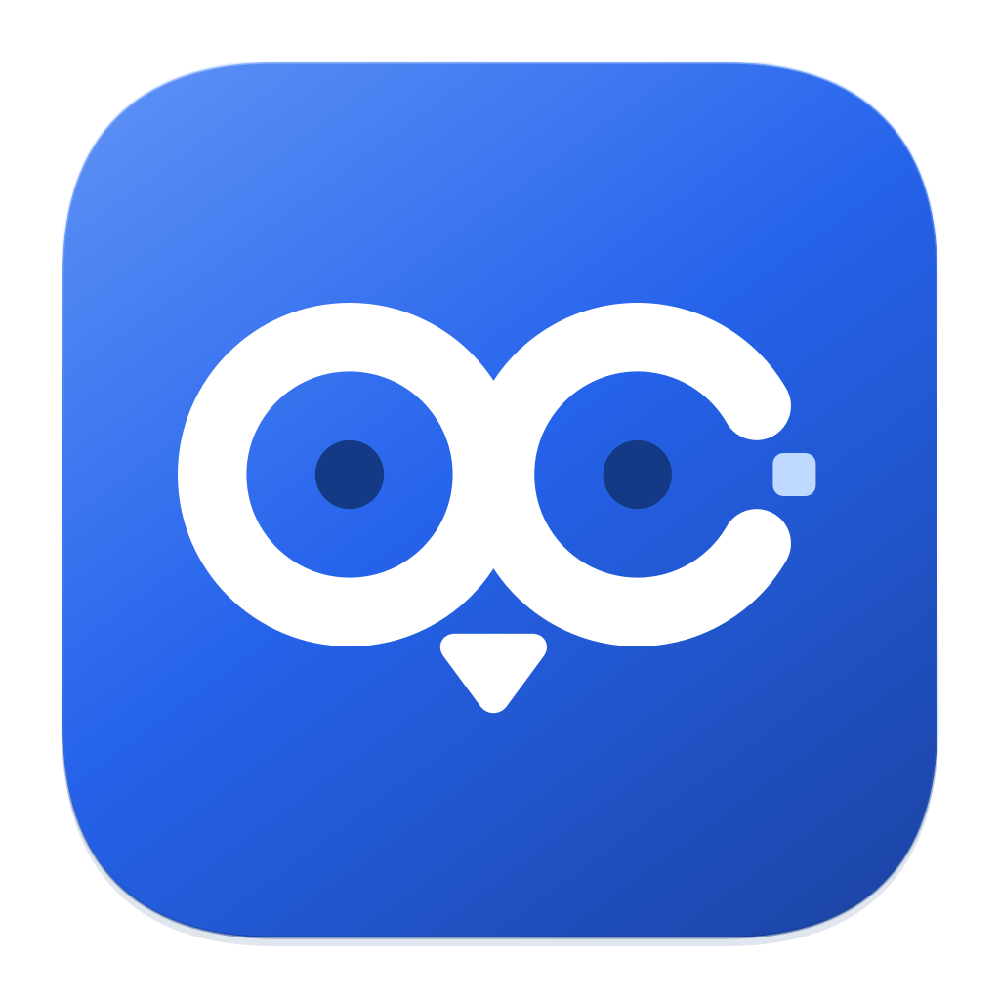
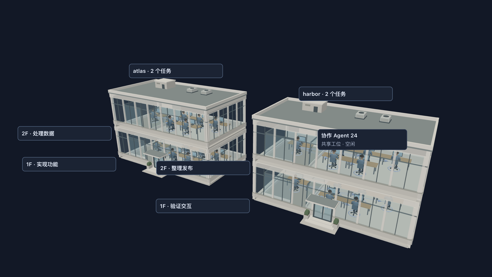
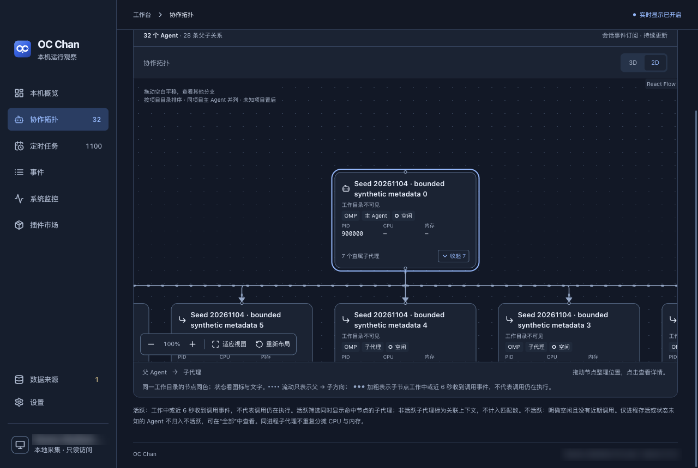

<p align="center">
  
</p>

<h1 align="center">OC Chan</h1>

<p align="center">
  <a href="README.md">简体中文</a> · <strong>English</strong>
</p>

<p align="center">
  <strong>See your Mac's agents, scheduled tasks, and system status.</strong>
</p>

<p align="center">macOS · Apple Silicon · Local, read-only observation</p>

<p align="center">
  <a href="#features">Features</a> ·
  <a href="#installation">Installation</a> ·
  <a href="#supported-sources">Supported sources</a> ·
  <a href="#development">Development</a> ·
  <a href="#documentation">Documentation</a>
</p>

<p align="center">
  
</p>

<p align="center"><sub>Screenshot of the actual 3D renderer using synthetic demo data.</sub></p>

When you run several agents and background tasks at once, OC Chan gives you one desktop window to find their working directories and sessions, check task status, and inspect your Mac's resource usage.

## Features

### See how agents work together

In the default 3D view, each project occupies a building, and each main session task and its subagents occupy a floor. Main agents have private offices; subagents share open desks. Select a task floor to look inside and click an employee for details. You can also switch to a 2D relationship graph to search, collapse branches, and adjust the layout. Parent–child relationships come from collected evidence; branches with missing parents or cycles are marked as unassigned.

<details>
<summary>See the 2D collaboration view</summary>



The same synthetic demo data in 2D, with edges showing main agents and their subagents.

</details>

### Return to an agent's session

Right-click a linked OMP node to jump to its Tern tab. For subagents, OC Chan follows the confirmed parent chain to the main session. It verifies the destination again before navigating and reports sessions that have closed or changed. First-time setup requires Tern integration and macOS Accessibility permission. See the [navigation guide (Chinese)](docs/features.md#协作拓扑画布).

### Inspect scheduled tasks and their results

View launchd, cron, OMP, and Hermes tasks together, filtering by type, scope, status, or name. Hermes tasks include per-run history, duration, and delivery results. Confirmed execution and delivery failures, sustained data-source outages, and recoveries appear in the local event list. Notifications are off by default; you can subscribe by source or task.

### Add system monitoring when you need it

Install the official system-monitor plugin from the in-app Plugin Marketplace to view CPU, memory, and network trends, disk space, and processes ranked by CPU or memory usage. The menu-bar panel can combine agent, task, and system summaries.

Installed plugins appear under Plugins in the sidebar; open Plugins → System monitor to access system monitoring. Entries appear after installation, remain visible when collection is disabled, and disappear after uninstallation.

System monitoring is not installed automatically on first launch. The bundled plugin package supports offline installation; online checks and updates require its release source to be available. See the [Plugin Marketplace guide (Chinese)](docs/architecture.md#插件市场与独立插件包) for installation, removal, and updates.

The interface supports Chinese and English, light and dark modes, and six themes. Native Liquid Glass is available on macOS 26 and later and respects system accessibility settings.

## Supported sources

Each source provides different evidence. A running process, active work, and recent calls are shown separately; unknown states are never reported as zero.

| Source | Available information | Main limitations |
| --- | --- | --- |
| OMP / Tern | Sessions, parent–child relationships, main-session activity, recent calls, and navigation to Tern | The exact number of actively executing subagents is not yet available |
| Codex CLI / desktop | Current sessions, working directories, and relationships that can be confirmed | No precise activity status, recent calls, or navigation to external windows |
| Claude Code / OpenCode CLI | Running processes and readable metadata | Process evidence alone does not imply active work |
| Hermes | Scheduled tasks, execution status, per-run history, and confirmed exception events | Status depends on database and process evidence; insufficient evidence remains unknown |
| launchd / cron | Task configuration, schedules, and readable status | No unified per-run history or prediction of the next run time |

OC Chan observes upstream agents and tasks without modifying them. It does not run scheduled tasks, terminate agents, or change parent–child relationships. Collected data stays on your Mac; session bodies are not uploaded. App and plugin updates connect to their respective release sources. See [coverage and privacy boundaries (Chinese)](docs/features.md#已知可见性边界).

## Installation

Currently intended for **Apple Silicon Macs**. Intel Macs are outside the current support and validation scope. The source repository and Actions artifacts remain private.

With repository access, download the `oc-chan-macos-arm64-<run-number>` artifact from a successful [Build macOS run](https://github.com/Zixiaobowen/oc-chan/actions/workflows/build.yml). It contains a DMG, ZIP, and checksum manifest. Verify the source and checksums before installing; see [local delivery and manual upgrades (Chinese)](docs/distribution.md#本地交付与手动升级).

Local and ordinary CI builds use ad-hoc signing, which is not Developer ID signing or Apple notarization. Formal signing, notarization, and in-place updates for signed builds still require validation. In-app updates apply only to installed builds signed with Developer ID. See [release and update requirements (Chinese)](docs/distribution.md#应用内更新).

## Development

Use **Rust 1.99 (pinned by the repository), Node.js 22.12+ (24 recommended)**, npm, and Xcode Command Line Tools with the macOS 26 SDK or later. Run these commands from the repository root. The default starts a real headless Tauri / WKWebView instance without a desktop window. Automated native input validation requires macOS 26 or later:

```sh
npm ci
npm run dev
```

To inspect the desktop interface manually, use:

```sh
npm run dev:window
```

Development instances use isolated settings, Cargo build directories, and authenticated Unix sockets. They do not read or overwrite the installed app's personal settings. Press Ctrl+C to exit and drain the instance. Node is used only for build and development tools; the production backend runs in Rust. See the [development guide (Chinese)](docs/development.md) for headless debugging, targeted validation, and packaging commands.

## Documentation

The following documents are currently in Chinese:

- [Features, controls, and data boundaries](docs/features.md): topology, task history, local events, notifications, and settings.
- [Development and validation](docs/development.md): environment setup, headless debugging, targeted tests, and performance validation.
- [Installation, builds, and releases](docs/distribution.md): delivery, upgrades, CI, signed updates, and local cleanup.
- [Architecture and plugins](docs/architecture.md): collector lifecycle, standalone plugin packages, IPC, and brand assets.
- [Performance baseline](docs/performance-baseline.md): measured workloads, results, and untested scenarios.
- [Product scope](PRODUCT.md) · [Design guidelines](DESIGN.md) · [Engineering rules](AGENTS.md).
