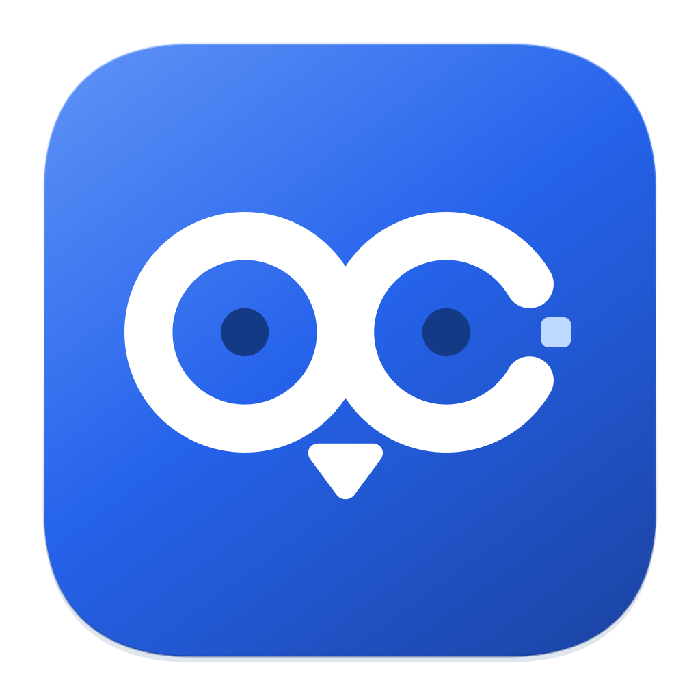

# OC Chan

在一个 macOS 桌面应用里，查看本机 AI Agent 的协作关系、定时任务和系统资源。

当你同时运行多个编程助手、维护后台任务，或想知道电脑正在忙什么时，OC Chan 将这些信息汇集到主窗口和菜单栏。它以观察为主，不会替你执行任务，也不会修改 Agent 的协作关系。

目前处于早期开发阶段，支持 Apple Silicon（M 系列）Mac。Intel Mac、Windows 和 Linux 不在当前支持范围内。

## 可以用它做什么

- **查看 Agent 协作**：识别 OMP、Codex、Claude Code 和 OpenCode 的本机进程；根据可获取的会话证据展示 OMP、Codex 的父子代理关系。默认以 3D 办公楼按工作目录组织 Agent，也可切换到 2D 关系图。
- **了解定时任务**：集中查看 launchd、当前用户 crontab、OMP 和 Hermes 的任务配置、计划与状态；Hermes 任务可进一步查看逐次执行历史。
- **观察系统资源**：查看 CPU、内存、交换空间、磁盘容量、默认网卡流量和进程排行，在菜单栏快速查看摘要与趋势。
- **追踪异常**：查看 Hermes 执行失败、投递失败，以及数据来源不可用与恢复事件；按需开启本机通知。
- **调整桌面体验**：支持简体中文与 English、浅色与深色、多套主题、字体和文字大小，以及可调强度的 Apple 原生 Liquid Glass。可配置托盘点击行为、Dock 图标、登录启动和防止空闲休眠。

不同工具提供的数据不同。进程存在不等于正在工作；没有足够证据时，OC Chan 会显示“未知”或覆盖限制，不把读取失败当作零。

## 安装与运行

当前可从源码构建，或在仓库的 **Actions → Build macOS** 中查找成功构建的 Artifacts。构建产物名为 `oc-chan-macos-arm64-<运行编号>`；下载 Actions 产物通常需要登录 GitHub，并受产物保留期限制。

正式 Developer ID 签名、公证和公开 Release 分发尚未完成验证。普通构建使用 ad-hoc 签名，不能视为已通过 Apple 公证的正式安装包；macOS 可能阻止打开。请保留系统提示用于反馈，不要关闭系统安全防护。

下载构建产物后：

1. 解压外层归档，在产物目录执行 `shasum -a 256 -c SHA256SUMS.txt` 核对文件完整性。
2. 打开 DMG，将完整的 `OC Chan.app` 放入“应用程序”；也可从应用 ZIP 中取出完整应用。
3. 升级前退出旧版并保留旧应用副本，再整包替换。不要合并新旧应用包里的文件，也不需要删除个人设置。

哈希校验用于确认文件完整性，不能替代开发者签名认证。安装包不需要 Node.js 或编译器。

### 从源码运行

需要 Apple Silicon Mac、Node.js 24、npm，以及提供 macOS 26 或更新 SDK 的 Xcode / Command Line Tools。原生 Liquid Glass 需要 macOS 26 或更新系统；其他系统版本上的运行能力尚未完整验收。

克隆本仓库并进入目录后执行：

```sh
npm ci
npm exec -- install-electron
npm run dev:window
```

`install-electron` 下载锁定依赖对应的 Electron 二进制。`dev:window` 打开可见的开发窗口，并使用独立临时配置，不改写正式应用的个人设置；退出后不保留该开发实例的偏好。

需要安装到本机并保留日常使用设置时：

```sh
npm run install:local
```

该命令会构建当前工作目录（包括未提交的改动）、退出已有 OC Chan、替换 `/Applications/OC Chan.app` 并检查新应用是否就绪。失败时会尝试恢复旧包，并报告具体错误。

只生成安装包、不安装或启动应用：

```sh
npm run dist
```

DMG 和 ZIP 输出到 `release/`。详细构建、校验与手动升级步骤见[开发与维护指南](docs/development.md)。

## 开始使用

打开应用后，可先在“概览”查看汇总，再进入对应页面：

- **Agent**：按类型、活动状态或关键词筛选，点击员工或节点查看详情。3D 视图中拖动空白处旋转、Shift 拖动平移、滚轮缩放，按 `F` 适应全楼；更关注父子关系时可切换到 2D。
- **定时任务**：按类型、范围、状态或名称筛选，点击任务查看配置与执行历史。不支持历史的来源会明确标注。
- **系统**：查看资源趋势和 CPU／内存进程排行。
- **事件**：按来源、类型与时间筛选异常记录，并定位到相关任务或数据来源。
- **数据来源**：查看每个来源的支持能力、采样时间和错误，重试可恢复的故障，或关闭不需要的采集。
- **左下角设置**：调整外观与桌面行为，管理通知、权限和更新。

关闭主窗口后，应用仍可在菜单栏运行；从菜单栏右键菜单可重新打开或退出。暂停显示只冻结当前查看内容，后台仍会采集；需要停止某类采集时，请在“数据来源”中关闭它。

OMP 会话在满足关联条件时，可从节点菜单跳转到对应 Tern 标签页。此功能需要安装 Tern，并授予 OC Chan 辅助功能权限；首次跳转会安装随包提供的 Tern 窗口导航插件。设置页提供系统权限页面入口，打开页面本身不会授予权限。

本机通知默认关闭。需要提醒时，在设置中开启、选择关注的来源或 Hermes 任务，并请求系统通知权限；系统专注模式等设置仍会影响实际投递。

## 数据与隐私

监控在本机进行，不需要配置模型 API Key。界面不加载远程网页或字体，监控数据不上传到云端。

采集器读取本机进程、任务配置和当前会话的必要元数据。OMP 的近期调用只展示工具名、模型标识和时间等字段，不展示提示词、工具参数或结果正文；Codex 只读取当前会话头部，不解析聊天正文，也不扫描历史会话目录。Hermes 执行数据库以只读方式访问。

应用会在自己的用户数据目录保存偏好、本地事件和通知去重记录。事件保留最多 7 天，并受条数和空间上限限制；不会保存任务输出或聊天正文。更新检查会访问 GitHub 的固定公开分发源，下载与安装需要用户操作。

反馈问题时，可在“数据来源 → 脱敏诊断”先预览，再选择复制或保存报告。报告不会自动上传。截图仍可能包含会话标题、任务名称或本机路径，请在公开分享前自行检查。

## 当前限制

- OMP 的精确活跃子代理总数仍不可用；Codex 子代理和桌面会话的执行状态可能显示未知。Claude Code、OpenCode 的进程识别不代表已支持其完整协作关系。
- 逐次任务执行历史目前仅支持 Hermes。launchd／cron 的计划配置和最近退出码不能替代执行历史，也不提供可靠的下一次执行时间推算。
- OMP 自定义会话目录、隔离 profile、其他用户的 crontab、容器及第三方应用内部调度不在当前覆盖范围。
- 原生 Liquid Glass 会在系统开启“减少透明度”或“增加对比度”时停用，并保留所选强度。
- 开发模式和本地 ad-hoc 包可以手动检查新版，但不自动检查，也不能在应用内下载和安装更新。正式签名版本的完整升级链路仍待验收。
- 登录启动、系统通知投递、VoiceOver 和长时间运行等场景仍有待补齐的验收；现有测试结果不能代表所有机器和系统版本。

## 反馈与参与

欢迎通过本仓库的 **Issues** 提交使用问题、数据来源适配建议和功能需求，通过 **Pull Requests** 提交改进。较大的功能或架构调整，建议先开 Issue 讨论使用场景与范围。

报告问题时，请附上应用版本或源码提交、macOS 版本、芯片型号、复现步骤、预期与实际结果；如涉及采集，可补充脱敏诊断。不要提交凭据、完整会话文件或未经检查的个人日志。

开发使用 Electron、React 和 TypeScript。采集与集成通过插件契约组织，目前只注册内置插件，不加载任意第三方插件。主要代码位于：

- `src/main/`：采集、插件、事件、设置与桌面集成。
- `src/preload/`、`src/shared/`：受限 IPC 接口与共享契约。
- `src/renderer/src/`：主窗口、拓扑与菜单栏界面。
- `src/native/`：macOS 原生模块。
- `scripts/`：开发启动、构建、安装与验证工具。

自动化开发默认使用无可见窗口的真实 Electron 实例：

```sh
npm run dev
```

提交 PR 前运行与改动相关的检查。例如：

```sh
npm run typecheck
# 查看某个改动文件对应的测试计划；去掉 --plan 执行所选测试
npm run test:ci -- --plan src/renderer/src/AgentTopology.tsx
# 涉及桌面渲染与交互时，运行隔离的真实 Electron 检查
npm run smoke:renderer
```

请阅读[工程约定](AGENTS.md)和[开发与维护指南](docs/development.md)。[产品说明](PRODUCT.md)介绍产品范围，[设计说明](DESIGN.md)记录界面设计，[待办清单](docs/oc-chan-todolist.md)记录实现与验收进展。提交时说明改动目的、验证方式及尚未覆盖的场景。

## 许可证

源码仓库已公开，但目前尚未指定开源许可证，`package.json` 的许可证字段为 `UNLICENSED`。公开可见不等于授予通用的使用、修改或再分发许可；相关授权范围需与维护者确认。

第三方组件保留各自许可证，构建产物包含对应声明。界面图标使用 [Kubai Icons](https://icons.kubai.design/)（MIT）。
